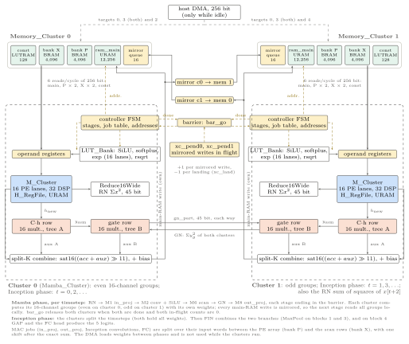
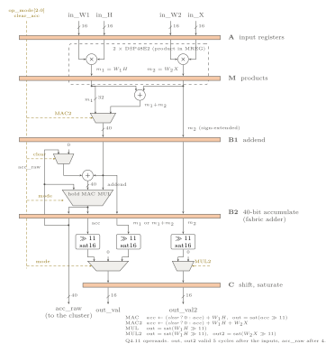
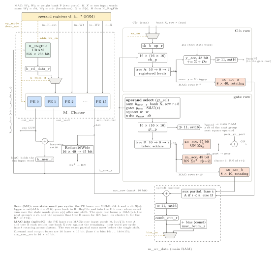
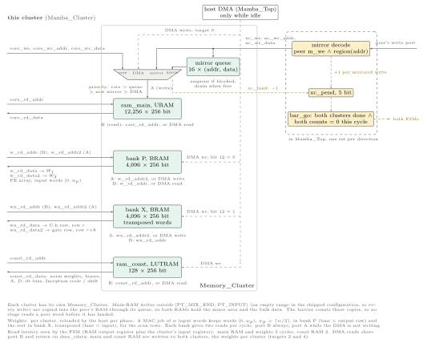

# ITMN-Mamba2 accelerator RTL

Verilog accelerator for an ECG classifier with Mamba2 mixers, in Q4.11 (16-bit) fixed point, on the Kria KV260
(xck26-sfvc784-2LV-c) at 250 MHz. The whole network runs on chip, from the raw 12-lead ECG to the 5 class logits.

| | |
|---|---|
| Task | PTB-XL, 5 super-diagnostic classes (NORM, MI, STTC, CD, HYP), multi-label, 12 leads x 1,000 samples |
| Model | encoder, 5 blocks of Inception and a Mamba2 mixer (d_state 16, headdim 32), GAP, FC; 398,509 parameters |
| Accuracy, test fold (2,158 records) | macro AUC 0.919 with the integer model the RTL implements (float model 0.927) |
| Latency per record | 2,474,261 cycles = **9.90 ms** at 250 MHz (compute only) |
| Work per record | 223.5 M MAC = 0.447 GOP, **45.2 GOP/s** (71 % of the 64 GOP/s peak) |
| Resources (post-route, out of context) | 56,072 LUT, 37,878 FF, 116 BRAM, 32 URAM, **146 DSP**, WNS +0.071 ns |
| Power (Vivado estimate) | 2.03 W, 20.0 mJ per record, 22.3 GOP/s/W |

## Comparison

Full tables, footnotes and references: [`results/comparison.md`](results/comparison.md). Other designs' figures are
from their papers; our power is a Vivado estimate of the accelerator alone, theirs are mostly board measurements.

| Design | Workload | Device | Arithmetic | kLUT | DSP | GOP/s | GOP/s per DSP | GOP/s/W |
|---|---|---|---|---|---|---|---|---|
| FastMamba | Mamba2-2.7B decode | VC709 | W8A8 | 334.8 | 3,333 | 30.7 * | 0.009 | 3.3 |
| LightMamba | Mamba2-2.7B decode | VCK190 | W4A4 | 107 | 228 | 38.9 * | 0.171 | 12.3 |
| SpecMamba | Mamba2-2.7B decode | VCK190 | INT4 | 536 | 1,106 | 111 * | 0.100 | - |
| LowRank-SSM | Mamba2-2.7B decode | VC1902 | INT8 weights | 233.5 | 1,624 | 90.7 * | 0.056 | 13.2 |
| MINA | 1-D CNN, ECG beats | ZCU102 | 16-bit | 24.7 | 40 | 9.85 | 0.246 | - |
| **This work** | **ITMN-Mamba2, 12-lead ECG** | **KV260** | **16-bit** | **56.1** | **146** | **45.2** | **0.310** | **22.3** |

\* dense-equivalent: 2 operations per parameter per generated token, times the reported tokens per second.

The same model in float at batch 1: 20.3 ms on a Core i5-12500H (8 threads), 10.1 ms and 326 mJ on a GeForce RTX 3050
Laptop, against 9.90 ms and 20.0 mJ (estimate) here.

## Folders

| Path | Contents |
|---|---|
| `itmn_m2/` | the design: RTL (`src/`), testbenches (`tb/`), simulation and synthesis scripts; see its README |
| `goldens/itmn_m2/` | weights, input and expected value of every stage for one test record, from the trained model |
| `ref/itmn_m2_ref.py` | integer reference of the whole network in numpy; recomputes every golden file from the weights |
| `results/` | cycles per block and per stage, post-route utilization, timing and power reports |
| `docs/` | block diagrams of the datapath, PE, PE cluster and memory system |

## Architecture

Two identical clusters run stage by stage in lockstep. Each has a controller, a 16-lane PE array (2 DSP48E2 per lane,
40-bit accumulators), two 16-multiplier fabric rows with adder trees (the scan rows), the nonlinear tables and its own
memories: a main RAM (UltraRAM, 256-bit words of 16 values), a weight RAM (block RAM, banks P and X of 4,096 words,
two reads per cycle), a constant RAM and the scan state RAM (UltraRAM).

- **Work split.** Projections and the scan split output groups of 16 rows by parity between the clusters; the
  Inception phase splits timesteps. Each cluster mirrors its writes into the peer's main RAM through a 16-entry queue,
  and a barrier releases both clusters once every write of the stage, mirrored ones included, has landed.
- **Mixer, per timestep.** RMSNorm, in_proj, causal conv with SiLU, the scan (dt, exp(dt A) and the SiLU gate fused
  into it), gated RMSNorm, out_proj. The block output, MaxPool and GAP run as one pass after the timestep loop.
- **Scan.** One (channel, state word) pair per cycle: the PE array updates 16 states with one MUL2, the C*h row
  reduces C*h exactly, and the gate row forms x*dt for the next group and y*SiLU(z) for the previous one.
- **MAC jobs.** in_proj, out_proj, every Inception convolution and the FC split their input words between the PE
  array (bank P) and the two scan rows (bank X, transposed); the two exact partial sums are added before the single
  shift and saturation. The gate row also accumulates the sums of squares for the gated RMSNorm and for the next
  timestep's input RMSNorm.

Block diagrams (`docs/`, drawn from the RTL):

| [PE lane](docs/pe.svg) | [PE cluster](docs/cluster.svg) | [Memory system](docs/memory.svg) |
|---|---|---|
|  |  |  |

## Reproduce

Tools: ModelSim (tested with ModelSim-Altera Starter 13.0sp1), Vivado 2022.1, Python 3 with numpy.
Run the simulations from `itmn_m2/`. Each testbench compares every checked value with the goldens and prints `PASS`
only if all match.

| Check | Command (from `itmn_m2/`) | Expected |
|---|---|---|
| Mamba2 mixer of block 0, 8 timesteps | `vsim -c -do "set ITM_BK 0; set MIX_T 8; do run_m2_mix_sim.do"` | 3,760 cycles, PASS |
| Inception phase of block 0, 60 timesteps | `vsim -c -do "set ITM_BK 0; set INC_T 60; do run_itm_inc_sim.do"` | 12,507 cycles, PASS |
| one block, both phases, 60 timesteps | `vsim -c -do "set ITM_BK 4; set BLK_T 60; do run_itm_block_sim.do"` | Inception 42,237 + Mamba2 71,613 cycles, PASS (with GAP and FC) |
| raw ECG to logits, all blocks (about an hour) | `vsim -c -do "do run_itm_e2e_sim.do"` | 2,474,261 cycles, logits 3488, -2087, -3410, -1794, -3469 |
| post-route at 4.0 ns (about an hour) | `vivado -mode batch -source run_synth_kv260.tcl` | see `results/` |
| integer reference (from the root) | `python ref/itmn_m2_ref.py` | `ALL OK` |
| memory layout and split-K address model | `python itmn_m2/scripts/m2_layout.py`, `python itmn_m2/scripts/splitk_model.py` | `LAYOUT OK`, `ALL BYTE-EXACT` |

`set LIBN <name>` gives a run its own work library, so several runs can share the folder.

## Notes on the numbers

- Cycle counts are compute only, from `start` to `done_all` of each phase. Loading the weights of a block between
  phases is not included.
- Synthesis is out of context (the 256-bit host port exceeds the package I/O): ideal clock, the host port and the
  block configuration inputs false-pathed, vectorless power. A system integration adds an AXI wrapper around it.
- The accuracy figures come from the integer model over the full test fold; the RTL equals that model on the records
  simulated end to end (the golden record here, and four more during development).
- The RTL also supports d_state 32, 64, 128 and headdim 16, 64 (`M2_SV`, `M2_PSHV` in `itmn_m2/sim_common.tcl`);
  those configurations need goldens of their own size, which are not included.
