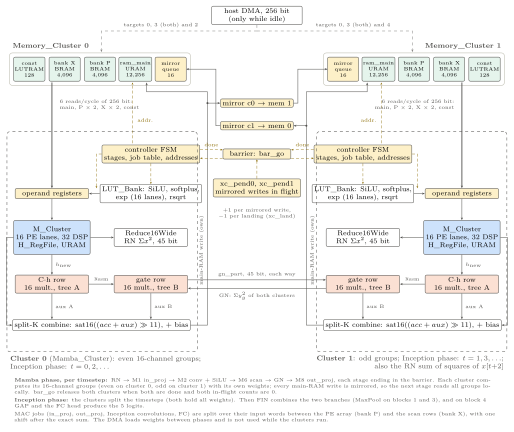
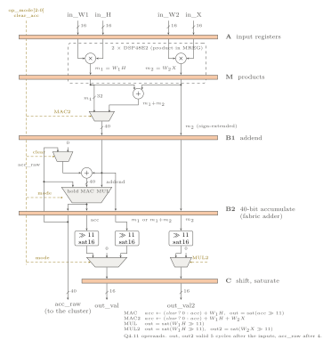
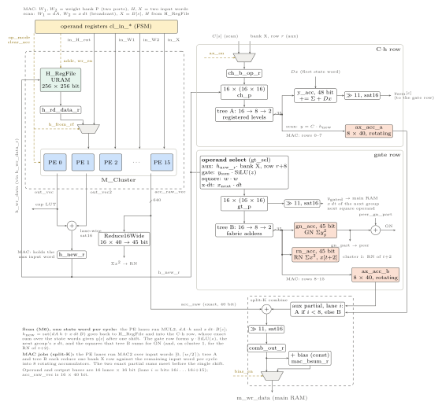
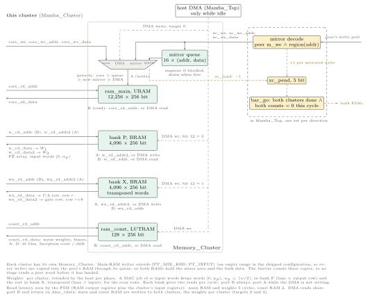

# Block diagrams

Drawn from the RTL in `itmn_m2/src/`; signal names are those of the source.

| Figure | Source module(s) | Shows |
|---|---|---|
| [datapath.svg](datapath.svg) | `top/Mamba_Top.v` | the two clusters, their memories, mirrored writes, the stage barrier and the GN exchange |
| [pe.svg](pe.svg) | `mamba/Mamba_PE_v2.v` | one PE lane: register stages A, M, B1, B2, C and the four modes |
| [cluster.svg](cluster.svg) | `mamba/M_Cluster.v`, `H_RegFile.v`, `Reduce16Wide.v`, the scan rows of `Mamba_Cluster.v` | the 16-lane PE array with the state RAM, the C*h row and gate row, and the split-K combine |
| [memory.svg](memory.svg) | `common/Memory_Cluster.v`, mirror logic of `top/Mamba_Top.v` | main RAM with its write arbiter and mirror queue, weight banks P and X, const RAM |






## Rebuilding

The sources are TikZ (`src/fig_*.tex`, shared style in `src/figstyle.tex`). Each builds to a standalone PDF:

```
cd docs/src
pdflatex fig_datapath.tex          # or tectonic fig_datapath.tex
pdftocairo -svg fig_datapath.pdf ../datapath.svg
pdftoppm -png -r 250 -singlefile fig_datapath.pdf ../datapath
```

The figures can also be included in a LaTeX document with `\input` after loading `figstyle.tex`.
